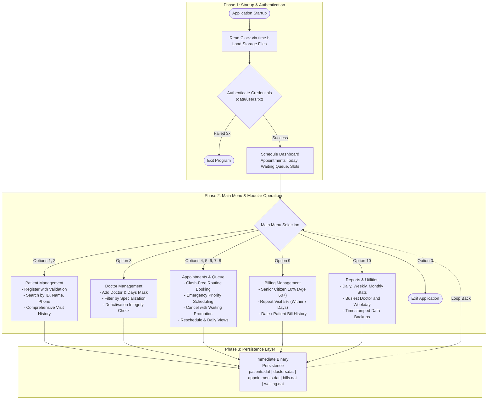

# Hospital Patient and Appointment Scheduling System

Console-based Hospital Patient and Appointment Scheduling System written in C using the standard library. The application automates patient record management, doctor scheduling, clash-free appointment booking, emergency priority queuing, consultation billing, and operational reporting.

## Problem Statement

Traditional hospital appointment registers often lead to scheduling collisions, double bookings, prolonged patient wait times, misplaced visit histories, and emergency cases queuing behind routine consultations. This project addresses these limitations through a structured console application featuring immediate file persistence, automated clash prevention, priority queuing, and structured billing.

## Objectives

- Maintain structured patient and doctor records in binary storage files.
- Prevent double bookings across doctors, time slots, and patient schedules.
- Prioritize emergency patients ahead of routine appointments using queue structures.
- Minimize waiting times via automated waiting list promotion upon cancellation.
- Generate itemized consultation bills with senior citizen and repeat visit discounts.
- Provide comprehensive reporting on clinic load, doctor utilization, and revenue.

## System Architecture

The application is engineered using modular programming principles with clean separation of concerns:

- `include/types.h`: Core data structures (`Date`, `Patient`, `Doctor`, `Appointment`, `Bill`, `WaitingEntry`) and system-wide constants.
- `include/utils.h` / `src/utils.c`: System clock retrieval, calendar date validation, weekday calculation, leap year handling, slot-to-time mapping, input parsing, and terminal formatting.
- `include/patient.h` / `src/patient.c`: Patient registration, ID generation, validation, search, record updating, and visit history tracking.
- `include/doctor.h` / `src/doctor.c`: Doctor profiles, specialization mapping, consultation fees, working day verification, and active status tracking.
- `include/appointment.h` / `src/appointment.c`: Appointment booking engine, slot availability checks, patient conflict prevention, cancellation with automatic waiting list promotion, rescheduling, and daily schedule views.
- `include/billing.h` / `src/billing.c`: Consultation bill generation, senior citizen discount evaluation (age 60+), repeat visit discounts (within 7 days), and bill history queries.
- `include/report.h` / `src/report.c`: Operational reports (daily, weekly, monthly), doctor workload and revenue statistics, cancellation rates, busiest doctor/day metrics, next available slot finder, follow-up reminders, and timestamped backups.
- `src/main.c`: Application entry point, multi-attempt credential authentication, live operational schedule dashboard, and main dispatch loop.
- `src/seed_data.c`: Standalone utility to populate sample doctors, patients, appointments, waiting queue entries, and consultation bills.

### Architectural Flowchart



## Data Design

### Struct Specifications

- Patient (`Patient`):
  - `id`: Unique integer auto-generated from 1001.
  - `name`: String of up to 50 characters.
  - `age`: Integer between 0 and 120.
  - `gender`: Character (`M`, `F`, `O`).
  - `phone`: 10-digit validated contact string.
  - `blood_group`: Blood group string (`A+`, `A-`, `B+`, `B-`, `AB+`, `AB-`, `O+`, `O-`).
  - `address`: String of up to 80 characters.

- Doctor (`Doctor`):
  - `id`: Unique integer starting from 101.
  - `name`: Doctor name string.
  - `specialization`: Clinical department (e.g., Cardiology, Pediatrics, Orthopedics).
  - `available_days`: 7-character mask representing Sunday (index 0) through Saturday (index 6).
  - `fee`: Floating-point consultation fee.
  - `slots_per_day`: Integer capacity per day (default: 16).
  - `is_active`: Status flag (1 = active, 0 = deactivated).

- Appointment (`Appointment`):
  - `id`: Auto-generated unique appointment number.
  - `patient_id`: Reference to registered patient.
  - `doctor_id`: Reference to consulting doctor.
  - `date`: Calendar date struct (`day`, `month`, `year`).
  - `slot`: Time slot index (1 to 16).
  - `type`: `TYPE_ROUTINE` (0) or `TYPE_EMERGENCY` (1).
  - `status`: `STATUS_BOOKED` (0), `STATUS_COMPLETED` (1), `STATUS_CANCELLED` (2), `STATUS_NOSHOW` (3).
  - `notes`: String up to 100 characters.

- Bill (`Bill`):
  - `id`: Unique bill serial number starting from 2001.
  - `appointment_id`: Reference to completed appointment.
  - `fee`: Doctor consultation fee.
  - `discount`: Total discount amount applied.
  - `total`: Net payable amount.
  - `date`: Billing date struct.

- Waiting List Entry (`WaitingEntry`):
  - `patient_id`: Patient identifier.
  - `doctor_id`: Target doctor identifier.
  - `date`: Date of requested consultation.
  - `type`: Priority type (`TYPE_EMERGENCY` or `TYPE_ROUTINE`).

### Time Slot Configuration

Each clinical day is divided into 16 thirty-minute slots:
- Slot 1: 09:00 AM
- Slot 2: 09:30 AM
- Slot 3: 10:00 AM
- Slot 4: 10:30 AM
- Slot 5: 11:00 AM
- Slot 6: 11:30 AM
- Slot 7: 12:00 PM
- Slot 8: 12:30 PM
- Slot 9: 02:00 PM
- Slot 10: 02:30 PM
- Slot 11: 03:00 PM
- Slot 12: 03:30 PM
- Slot 13: 04:00 PM
- Slot 14: 04:30 PM
- Slot 15: 05:00 PM
- Slot 16: 05:30 PM

## Storage Files

Data persistence is managed through standard binary and text files located in the `data/` directory:
- `data/patients.dat`: Binary storage of `Patient` records.
- `data/doctors.dat`: Binary storage of `Doctor` records.
- `data/appointments.dat`: Binary storage of `Appointment` records.
- `data/bills.dat`: Binary storage of `Bill` records.
- `data/waiting.dat`: Binary storage of `WaitingEntry` queue elements.
- `data/users.txt`: Colon-delimited authentication credentials (`username:password`).

## Build and Execution

### Prerequisites

- GCC compiler (MinGW-w64 on Windows, or GCC on Linux/macOS)
- GNU Make or mingw32-make

### Building the Project

Compile the main executable:
```bash
make
```

On Windows environments using MinGW:
```bash
mingw32-make
```

### Seeding Sample Data

To compile and execute the standalone data seeder:
```bash
make seed
./seed_data
```

### Running the System

Execute the compiled application:
```bash
./hospital
```

Default credentials:
- Username: `admin` | Password: `admin123`
- Username: `receptionist` | Password: `hospital2026`

## Verification and Test Scenarios

The codebase satisfies the following validation constraints:
1. Double Booking Prevention: Attempting to book the same doctor, date, and slot twice is strictly rejected.
2. Patient Scheduling Conflict: A patient cannot hold multiple bookings in the identical time slot across different doctors.
3. Date Validation: Past dates are rejected; bookings are restricted to doctor working days within a 30-day forward window.
4. Leap Year Handling: Invalid dates such as 31-02-2027 are rejected, while valid leap year dates such as 29-02-2028 are accepted.
5. Waiting List Promotion: Cancelling an appointment automatically identifies the next waiting list patient for that doctor and date, promotes the patient, and books the freed slot.
6. Emergency Priority: Emergency bookings are prioritized for earliest available slots; when full, emergency patients are queued at the front of the waiting list.
7. Doctor Removal Integrity: Deactivating a doctor is refused if future booked appointments remain on their schedule.
8. Discount Precision: Senior citizen discount (10%) applies strictly for age 60 and above (not applied for age 59). Repeat visit discount (5%) applies for consultations within the past 7 days.
9. Robust Input Handling: Non-numeric entries on numerical prompts are handled gracefully without application crashes or buffer overflows.
10. Data Persistence: System state persists across application termination and reload.
